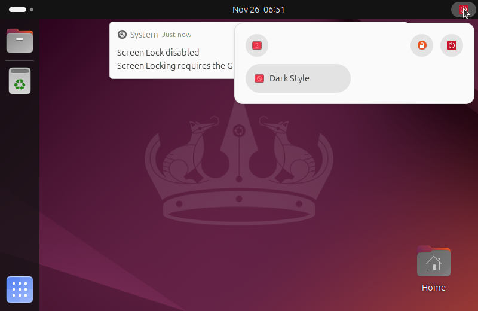

# Cloud Linux Workspace

在 Windows 解压客户端并双击 `Start.cmd`。配对后先看到原版 Ubuntu 桌面，点击 Dock 上的 ChatGPT 会在云端启动 OpenAI 的 Linux 程序。Windows 随包提供绘图运行时，在本地窗口执行 GNOME 和应用生成的绘图指令。云端保有会话、控件焦点和输入状态。[下载 Windows x64 客户端](releases/original-win64/cloud-workspace.zip) · [下载云端服务](releases/ubuntu-source/cloud-workspace-server.zip)

**第一次连接**需要在云机启动绘图服务。在装好依赖的 Ubuntu 24.04 云机上，解压云端服务，进入 `cloud-workspace-server` 目录，运行以下命令。终端会提供本次会话的配对码。在 Windows 输入该码和 InstaBox 密钥即可连接。使用 Debian 13 的云机有单独的安装入口。[云服务器准备](cloud_render/provision/README.md)

```sh
python3 -m experiments.original_desktop_source --port 17326
```

真实 InstaBox 会话中，Windows 连入云端，点击 Dock 打开 ChatGPT，再打开原厂登录前表单。五次键盘输入均由云端确认，本机显示相同的 `orbit`。云端默认使用临时配置。要在不同配对之间保留原程序的设置，可在云端启动命令中加入 `--profile "$HOME/.local/share/cloud-workspace/chatgpt-desktop"`。应用网络仍隔离，登录后的聊天和 Claude Artifacts 待验证。此轮 Windows x64 客户端运行于 Wine 10，实体 Windows 11 尚待验收。[真实云桌面](docs/measurements/instabox-win64/desktop.png) · [Windows 输入后的原厂窗口](docs/measurements/instabox-win64/input.png) · [此会话的时间和确认记录](docs/measurements/instabox-win64/session.json)

在同一台 InstaBox 上对比两个发布包，首次显示 Ubuntu 桌面所需的已压缩绘图数据从 9,887,960 字节降至 430,337 字节（减少 95.65%，未计外层 HTTPS 开销）。Windows 根据一条 84 字节引用，用随包的 Ubuntu 官方壁纸还原了 33,177,600 字节的原始纹理，并校验了全部四个通道。同一位置的 1200×750 个壁纸像素在两个版本中完全一致。此次从双击到看见桌面用时 20.44 秒，点击 Dock 后，在启动第 40.94 秒看见 ChatGPT 欢迎页。[首屏测量](docs/measurements/instabox-win64/first-desktop-5fe9.json) · [本次桌面实拍](docs/measurements/instabox-win64/5fe9-desktop.png) · [本次 ChatGPT 窗口](docs/measurements/instabox-win64/5fe9-welcome.png) · [断开后在本机重建绘图](docs/measurements/original-desktop-local-redraw.json)

两个发布 ZIP 也在独立 Ubuntu 与 Win64 之间配套验证过。从 Windows 打开同一扇窗口，依次点击 Dock、登录方式、原版表单，输入七个字符，再全选替换。七次增量绘图都还原出云端原程序提供的完整绘图指令。关闭窗口后，两端正常退出并释放本次会话。[两个发布包的验证记录](docs/measurements/paired-release-win64/receipt.json) · [全选替换后的原窗口](docs/measurements/paired-release-win64/native-replace.png)

## 连接基础 Ubuntu 桌面

只使用 GNOME 桌面、概览搜索和独立应用通道时，可以选用同时支持多种桌面分辨率的基础客户端。[下载基础桌面客户端](releases/thin-windows/cloud-workspace.zip)

如果你的 InstaBox 是 Debian 13 amd64，可在云机的本仓库目录运行 `python3 -m cloud_render.provision`，由云机校验 Ubuntu 官方软件包，启动一次性桌面。终端显示端口后即可配对，关闭该命令会回收本次 Ubuntu 环境。[Debian 云机的空间、启动与回收](cloud_render/provision/README.md)

在已具备 Ubuntu 桌面依赖的云机上运行 `python3 -m cloud_render.gnome_relay --port 17325`。在 Windows 解压完整客户端，打开 `Start.cmd`，输入 InstaBox 密钥和本次桌面配对码。服务仅监听云机回环，连接使用 InstaBox 的私有 HTTPS 通道。本机窗口支持指针移动、左右点击、导航键和 Ctrl+Esc 活动概览。可用 `--desktop-size 1920x1080` 请求全高清桌面，按默认参数启动时使用 800×520。Ubuntu 官方壁纸作为静态资源随包提供，匹配到相同源纹理时通过摘要引用。x64 使用内置运行时。ARM64 需要 Windows 11 x64 仿真，实机兼容性待验证。

下图来自发布包的实际窗口。双击启动的 Win64 程序通过 InstaBox 私有 HTTPS 连接原版 Ubuntu。鼠标点开快速设置后，本机窗口的 800×520 个像素与云端第 84 帧完全一致，并显示 “Dark Style”。按 Escape 后，菜单消失，窗口与第 125、126 帧相同。这次验证运行在 Wine 10，物理 Windows 11 仍待验证。[正式包的启动、操作和逐帧记录](docs/measurements/ubuntu-windows-launch.json) · [较早会话的结果](docs/gnome-command-stream.md)



## 从 Ubuntu Dock 打开原版 ChatGPT

应用桌面有独立的 Win64 客户端和云端服务。进入桌面后点击 Dock 中的 ChatGPT 图标，云端启动原版程序。本机用 CanvasKit 绘制程序提供的 Skia 指令，再由 Win64 VirGL 按 GNOME 的指令将窗口合成到桌面中。已在隔离的 Ubuntu 与 Win64 客户端之间验证点击欢迎页、打开登录方式。此入口需要云端安装指定版本的 ChatGPT 和绘图依赖。[桌面应用的启动与实拍](docs/interactive-original-desktop.md)

完整云桌面还支持在原版概览搜索框中使用 Windows 输入法。候选词在本机选择，提交后云端原搜索框更新文字和结果。已在原控件验证中文、退格、全选替换、取消和失焦，并与独立读取的 Win32 窗口核对像素。[原生输入法验收](docs/gnome-search-ime.md)

应用内容变化时，两端可协商复用同一窗口中已经验证的绘图数据。每次重组都校验原图完整 SHA-256。在两态真实云录制的五轮回放中，协议数据量中位数从 2,396,121 字节降到 812,591 字节，重建的两幅原图和全部 38,001,652 字节 GPU 指令均相同。[绘图复用与操作耗时记录](docs/measurements/original-application-delta.json)

在独立 Ubuntu 云端会话中，使用同一专用配置目录重新打开原厂应用，应用自行保存的窗口尺寸和首次启动时间一致。原版输入框的光标闪烁也会产生新的绘图。在云端重新核对画面期间，点击可能需要重试。已观测到用户重新点击 Cancel 后，原程序收到按下、松开并返回登录方式菜单。[跨会话设置](docs/measurements/original-cloud-profile.json) · [按钮动作与屏幕实拍](docs/measurements/original-app-pointer-surface.json)

在安装了 Chromium 的隔离 Ubuntu 云桌面，点击原版 ChatGPT 的登录按钮会由系统打开一扇独立的浏览器窗口。Mutter 记录到键盘焦点从 ChatGPT 切到 Chromium，在浏览器中按 Ctrl+W 后又回到原来的 ChatGPT 窗口。云端负责打开链接和接收应用回调。实测覆盖窗口交接，在线账户登录仍待完成。[原窗口与焦点的实测](docs/measurements/system-browser/actual-wayland-physical-focus.json) · [回调监听的实测](docs/measurements/chatgpt-system-browser-signin.json)

要单独验证系统浏览器内容区，可以在云端运行 `python3 -m cloud_render.browser_viewport_service --port 17328`，在 Windows 客户端运行 `Start.cmd --browser-viewport --instabox --port 17328`。在这一入口，原版 Chromium 打开固定的离线页面。Windows 执行它提供的 Skia 指令，点击「Details」由云端原控件处理。已经在 1000×813 内容区测到原控件展开、同一个 Windows 窗口更新。独立实验也重绘了浏览器自己的标签栏和地址栏。在线登录页以及浏览器在默认桌面中的完整合成仍待接入。[配对说明](docs/interactive-original-desktop.md) · [原版标签栏在 Win64 的绘图](docs/measurements/original-chromium-top/win32-chrome.png)

## 单独打开云端 ChatGPT

单独连接云端的 ChatGPT 绘图服务时，在 Windows 运行 `Start.cmd --cloud-app`。服务从原版 ChatGPT for Linux 提取 Skia 指令。本机的 Microsoft Edge 使用随包 CanvasKit 绘制原始界面，云端应用负责编辑状态、输入处理和账号。两条服务使用各自的配对码。[云端应用的安装与启动](docs/thin-client.md)

在真实云机上验证了欢迎页、登录方式菜单、测试文本输入、中文输入法提交、删除和取消返回。本机与云端独立截图取自同一个原厂窗口。已测试的 11 个操作均得到确认，一次测量的操作至下一画面中位数为 0.751 秒。登录后聊天和 Claude Artifacts 仍待验收。[本机原厂界面](docs/cloud-render-window.png) · [本机中英文输入](docs/cloud-render-input.png) · [云端原窗口](docs/cloud-render-input-source.png) · [传输与交互数据](docs/measurements/cloud-render.json)

GNOME 可以把普通应用已经绘好的整窗纹理作为资源上传。桌面客户端只接入有绘图来源验证的界面。应用在 Ubuntu 窗口内的原厂绘制需要逐个接入，已经在两个登录前状态验证了原厂页面和原厂标题栏的本机合成。目前默认桌面中的普通应用入口会提示绘图通道尚未就绪。下列记录给出了同一个原厂窗口的画面对照和在 Windows 上持续接收原始绘图的验证结果。[原厂界面与窗口合成实测](docs/application-surface.md) · [连续绘图的测量](docs/incremental-application-surface.md)

## 本机重绘原版 Claude

从 Claude Desktop 自带的开发者工具导出绘图时，可在云源核对它所属的主窗口和图层，再在本机 Win32 窗口重绘原厂文字、按钮和路径。已实测原版离线界面。实时交互、登录会话和 Artifacts 仍待接入。[Claude 原版窗口的导出、打开与测量](docs/claude-original-drawing.md)

## 显式兼容入口

`Start.cmd --native` 会在用户已经安装的本机 Ubuntu WSLg 内打开 GNOME。`Setup.cmd` 专用于这种模式。远端 Xfce 整屏和原有网页项目工作台分别使用 `python launcher.py --cloud-desktop`、`python launcher.py --workbench`。旧模式的桌面与官方客户端实拍保存在各自的验收记录中。[本地 WSLg 模式](docs/native-windows.md) · [云桌面与项目工作台](docs/remote-workbench.md)

### 兼容模式的项目文件

在“活动”里打开 **InstaBox 项目文件**，首次使用时选择云机和项目目录。选中的云端文本会出现在 Ubuntu 文件管理器里。双击即可用本机编辑器打开。Ctrl+S 保存到本机，在文件上右键选 **脚本 → 保存到 InstaBox** 才会更新云端。实际云机已独立核对编辑后的字节。[首次连接与使用方法](docs/native-project-files.md) · [编辑器实拍](docs/native-cloud-file-edit.png)

在 GNOME 的“活动”里搜索 **连接 InstaBox 到官方客户端**，选择 Claude 或 ChatGPT 的本地 Codex 项目，再确认云机与项目目录。首次使用会引导你选择项目，并按需准备连接组件。重新打开所选客户端后，请从其 MCP 设置查看 `instabox-workspace`。默认可以列目录、读文本和查询 Git 状态。选择“包含 Git 差异”后，也可以在原厂客户端里问“这个云项目最近一次提交改了什么”，或查看尚未提交的代码。账户、聊天记录和工具授权仍由厂商管理。[连接步骤与权限](docs/official-client-workspace.md)
