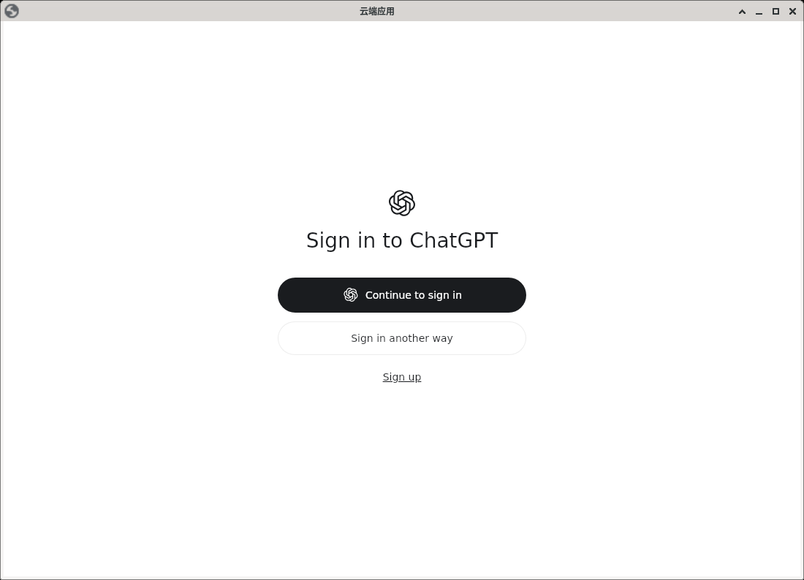

# Cloud Linux Workspace

Windows 本机运行轻量绘图客户端。应用进程、账号会话和项目文件放在云服务器上。云端从原程序正在显示的窗口取得 Skia 绘图指令，本机按显示比例重新绘制这些指令，点击则送回创建该窗口的云端进程。

当前接入的是 **ChatGPT for Linux** 的登录前窗口。客户端需要 Python 3.10+ 和已有的现代浏览器。浏览器在本机加载随包的 CanvasKit，显示并缩放云端原程序的画面。Ubuntu、ChatGPT 及其登录资料保存在云侧。Claude、整个 GNOME 桌面和登录后的对话仍在开发验收范围内。[绘图客户端](thin_client/) · [云端绘图服务](cloud_render/)

上图来自轻量客户端。另从同一云端窗口读取原画面，用来逐像素对照。真实测试覆盖了登录前窗口，断开连接后仍可在本机缩放已收到的画面。[点击后的本机画面](docs/cloud-render-chatgpt-options.png) · [同一云端窗口对照图](docs/cloud-render-source-options.png) · [首次出现的原厂登录页](docs/cloud-render-chatgpt-welcome.png) · [断线后的本机缩放](docs/cloud-render-offline-resize.png) · [真云操作与画面测量](docs/measurements/cloud-render.json)

## 连接工作区

[下载 Windows 轻量客户端](releases/thin-windows/cloud-workspace.zip)（x64 和 ARM64）

在云机的图形会话中运行 `python3 -m cloud_render.service`。Windows 上解压轻量客户端并双击 `Start.cmd`，按提示输入 InstaBox 凭证和当前绘图服务的配对码。客户端通过 InstaBox 私有接口接收云端绘图并发回点击。已有私有 TCP 转发时，也可以用 `Start.cmd --connect-port 端口号` 连接。[云端准备与客户端操作](docs/thin-client.md)

当前版本支持本地重绘、缩放、云端主动更新与鼠标主键单击。登录后的输入和对话、Claude Artifacts、完整 GNOME 桌面及 Windows 11 真机仍需验收。

## 显式兼容入口

`Start.cmd --native` 会在用户已经安装的本机 Ubuntu WSLg 内打开 GNOME。`Setup.cmd` 专用于这种模式。远端 Xfce 整屏和原有网页项目工作台分别使用 `python launcher.py --cloud-desktop`、`python launcher.py --workbench`。旧模式的桌面与官方客户端实拍保存在各自的验收记录中。[本地 WSLg 模式](docs/native-windows.md) · [云桌面与项目工作台](docs/remote-workbench.md)

### 兼容模式的项目文件

在“活动”里打开 **InstaBox 项目文件**，首次使用时选择云机和项目目录。选中的云端文本会出现在 Ubuntu 文件管理器里。双击即可用本机编辑器打开。Ctrl+S 保存到本机，在文件上右键选 **脚本 → 保存到 InstaBox** 才会更新云端。实际云机已独立核对编辑后的字节。[首次连接与使用方法](docs/native-project-files.md) · [编辑器实拍](docs/native-cloud-file-edit.png)

在 GNOME 的“活动”里搜索 **连接 InstaBox 到官方客户端**，选择 Claude 或 ChatGPT 的本地 Codex 项目，再确认云机与项目目录。首次使用会引导你选择项目，并按需准备连接组件。重新打开所选客户端后，请从其 MCP 设置查看 `instabox-workspace`。默认可以列目录、读文本和查询 Git 状态。选择“包含 Git 差异”后，也可以在原厂客户端里问“这个云项目最近一次提交改了什么”，或查看尚未提交的代码。账户、聊天记录和工具授权仍由厂商管理。[连接步骤与权限](docs/official-client-workspace.md)
