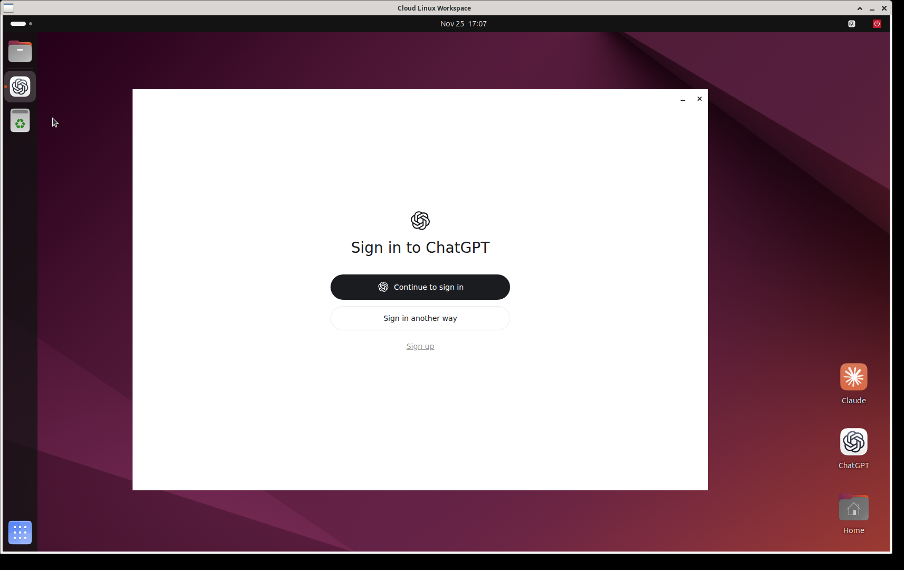

# Cloud Linux Workspace

Windows 上的主入口会在本机 Ubuntu WSL 2 中启动 GNOME Shell。桌面、应用菜单和文件管理器由本机的 Linux 进程绘制。运行桌面无需 InstaBox 密钥，项目数据通过单独配置的工作区连接传输。

在 Windows 11 上解压整个源码包。首次使用时，准备好带 WSLg 的 Ubuntu 24.04 WSL 2，双击 `Setup.cmd` 安装桌面依赖。以后直接双击 `Start.cmd` 进入 GNOME。启动程序会选择 x64 或 ARM64 版本。有多个 Ubuntu 时用 `Start.cmd --distro Ubuntu-24.04` 指定发行版。[Windows 准备和验收](docs/native-windows.md)

在 GNOME 的“活动”里搜索 **安装官方客户端**（英文为 **Install official desktop apps**），选择 ChatGPT、Claude 或两者，在 Ubuntu 终端确认 APT 安装。随后从“活动”或桌面图标打开应用。两个 Linux 客户端都使用厂商提供的桌面程序和图标，窗口由同一个本机 GNOME 桌面管理。各自的账户负责聊天和登录。InstaBox 提供授权项目的文件和计算。[Ubuntu 安装与启动](docs/native-windows.md#打开原版应用) · [官方客户端的项目连接](docs/official-client-workspace.md)

在 Ubuntu 24.04.5 上，已核对两款程序与厂商安装包，并用窗口管理器确认窗口归属。最小化整个工作区时，两款应用都随之隐藏。ChatGPT 在断网的全新用户目录里也能打开登录方式面板。Claude 在相同条件下会显示连接错误页，仍能展开 File 菜单。[两款应用的 GNOME 桌面实拍](docs/native-ubuntu-official-apps.png) · [断网后点击 ChatGPT 登录选项](docs/native-ubuntu-chatgpt-offline-options.png) · [Claude 原版窗口](docs/native-ubuntu-claude-menu.png)

Ubuntu 24.04 上的桌面窗口现在显示为 **Cloud Linux Workspace**。在 Windows 11 安装两款 Ubuntu 客户端后，可运行 `powershell.exe -NoProfile -File .\windows\Test-NativeWorkspace.ps1 -VerifyApps`。它通过日常入口打开桌面，先验证文件管理器，再记录每款应用在整个工作区最小化、还原前后的窗口和进程。当前公开的实拍来自 Linux。Windows 11 上的 WSLg 宿主窗口、Microsoft Store 应用及两款应用登录后的对话仍待实机验收。[带窗口标题的离线 Claude 实拍](docs/native-ubuntu-branded-claude.png) · [Windows 操作步骤](docs/native-windows.md#在-windows-上验证桌面窗口) · [实测记录](docs/measurements/native-windows-verifier.json)

## 工作区连接

在“活动”里打开 **InstaBox 项目文件**，首次使用时选择云机和项目目录。选中的云端文本会出现在 Ubuntu 文件管理器里。双击即可用本机编辑器打开。Ctrl+S 保存到本机，在文件上右键选 **脚本 → 保存到 InstaBox** 才会更新云端。实际云机已独立核对编辑后的字节。[首次连接与使用方法](docs/native-project-files.md) · [编辑器实拍](docs/native-cloud-file-edit.png)

在 GNOME 的“活动”里搜索 **连接 InstaBox 到官方客户端**，选择 Claude 或 ChatGPT 的本地 Codex 项目，再确认云机与项目目录。首次使用会引导你选择项目，并按需准备连接组件。重新打开所选客户端后，请从其 MCP 设置查看 `instabox-workspace`。该入口授予列目录、读文本和查询 Git 状态的权限。账户、聊天记录和工具授权仍由厂商管理。[连接步骤与权限](docs/official-client-workspace.md)

## 开发与验收

显式选用 Windows Store 客户端时，启动器按当前用户注册的应用身份唤起厂商程序。默认的本机 Ubuntu 工作区使用发行版的 GNOME Shell、Ubuntu Dock、Nautilus 和 Wayland。官方 ChatGPT 和 Claude 的登录前窗口与 Ubuntu 文件管理器已在 Linux 测试环境运行。Windows 11 实机窗口可用随包的验收脚本核对所有者。[Windows 启动器源码](windows/launcher/) · [Linux 会话源码](linux/) · [实测数据](docs/measurements/native-workspace.json)

如需使用已有的云端 Xfce，运行 `python3 launcher.py --cloud-desktop`；项目工作台使用 `python3 launcher.py --workbench`。这两个可选入口及历史版本的使用方法仍有完整记录。[远端桌面与工作台](docs/remote-workbench.md) · [开发交接](AGENTS.md)
