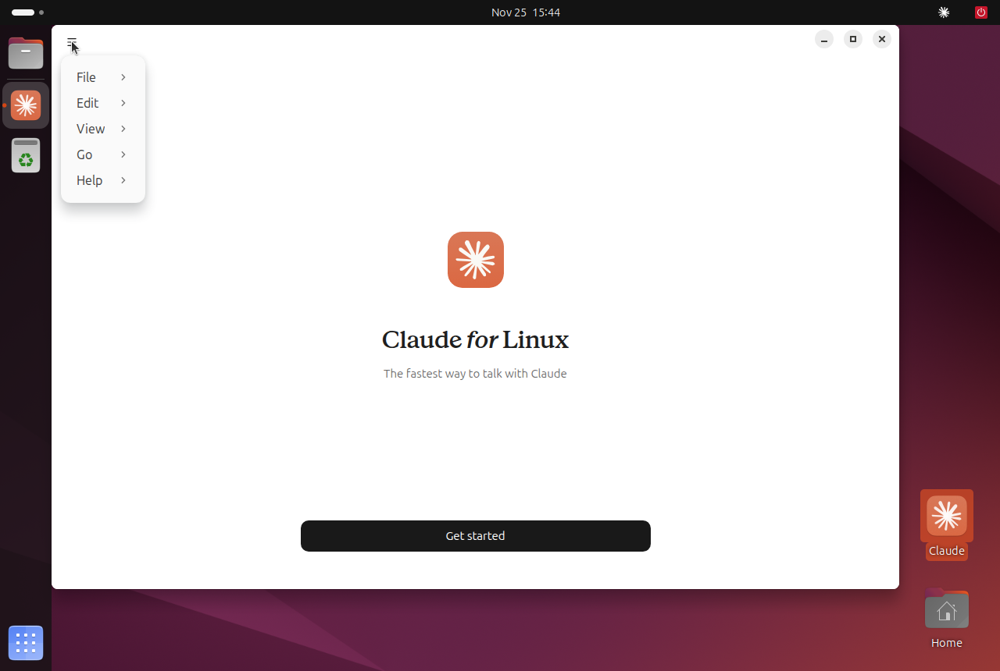

# Cloud Linux Workspace

Windows 上的主入口会在本机 Ubuntu WSL 2 中启动 GNOME Shell。桌面、应用菜单和文件管理器由本机的 Linux 进程绘制。运行桌面无需 InstaBox 密钥，项目数据通过单独配置的工作区连接传输。

在 Windows 11 上解压整个源码包。首次使用时，准备好带 WSLg 的 Ubuntu 24.04 WSL 2，双击 `Setup.cmd` 安装桌面依赖。以后直接双击 `Start.cmd` 进入 GNOME。启动程序会选择 x64 或 ARM64 版本。有多个 Ubuntu 时用 `Start.cmd --distro Ubuntu-24.04` 指定发行版。[Windows 准备和验收](docs/native-windows.md)

双击 Ubuntu 桌面上的应用图标，也可以按 Super 在 GNOME“活动”中搜索应用名称。已安装 Anthropic 官方 Linux 客户端时，Claude 在本机 GNOME 中运行，可用的对话、输入框和 Artifacts 由官方客户端提供。“ChatGPT（Windows 版）”调起已安装的 OpenAI Windows 应用，在 Windows 上拥有自己的顶层窗口。厂商账户分别登录。InstaBox 保存你指定项目里的文件，工作区连接按授权向官方应用提供数据。[官方客户端的项目连接](docs/official-client-workspace.md)

在 Ubuntu 24.04.5 上，从 GNOME 的“活动”启动 Claude 后，已核对运行中的程序与厂商软件包的 SHA-256。上图是退出后双击桌面图标重新打开程序，展开官方菜单时的登录前画面。另一次在全新用户目录里断网后双击启动，Claude 显示了自己的连接错误页，同一窗口仍能展开 File 子菜单。[断网冷启动原图](docs/native-ubuntu-claude-offline-menu.png)

Windows 上的 WSLg、ChatGPT 实际窗口和已登录对话仍待实机验收。[Ubuntu 桌面原图](docs/native-ubuntu-desktop.png) · [验收记录](docs/measurements/native-workspace.json)

## 工作区连接

在“活动”里打开 **InstaBox 项目文件**，首次使用时选择云机和项目目录。选中的云端文本会出现在 Ubuntu 文件管理器里。双击即可用本机编辑器打开。Ctrl+S 保存到本机，在文件上右键选 **脚本 → 保存到 InstaBox** 才会更新云端。实际云机已独立核对编辑后的字节。[首次连接与使用方法](docs/native-project-files.md) · [编辑器实拍](docs/native-cloud-file-edit.png)

通过官方客户端的本地 MCP 连接访问指定的 InstaBox 项目。默认可以查看目录、读取 UTF-8 文本和查询云端 Git 状态。显式启用保存后，修改已有文件时会核对读取版本。实测从云机读回了保存的字节，也验证了旧版本写入会收到冲突。ChatGPT 的本地连接适用于桌面端的 Codex 项目。[配置与账户范围](docs/official-client-workspace.md)

## 开发与验收

Windows 启动器按当前用户注册的应用身份唤起厂商程序。本机 Ubuntu 使用发行版的 GNOME Shell、Ubuntu Dock、Nautilus 和 Wayland。登录前的官方 Claude 与 Ubuntu 文件管理器已在 Linux 测试环境运行。Windows 11 实机窗口可用随包的验收脚本核对所有者。[Windows 启动器源码](windows/launcher/) · [Linux 会话源码](linux/) · [实测数据](docs/measurements/native-workspace.json)

如需使用已有的云端 Xfce，运行 `python3 launcher.py --cloud-desktop`；项目工作台使用 `python3 launcher.py --workbench`。这两个可选入口及历史版本的使用方法仍有完整记录。[远端桌面与工作台](docs/remote-workbench.md) · [开发交接](AGENTS.md)
