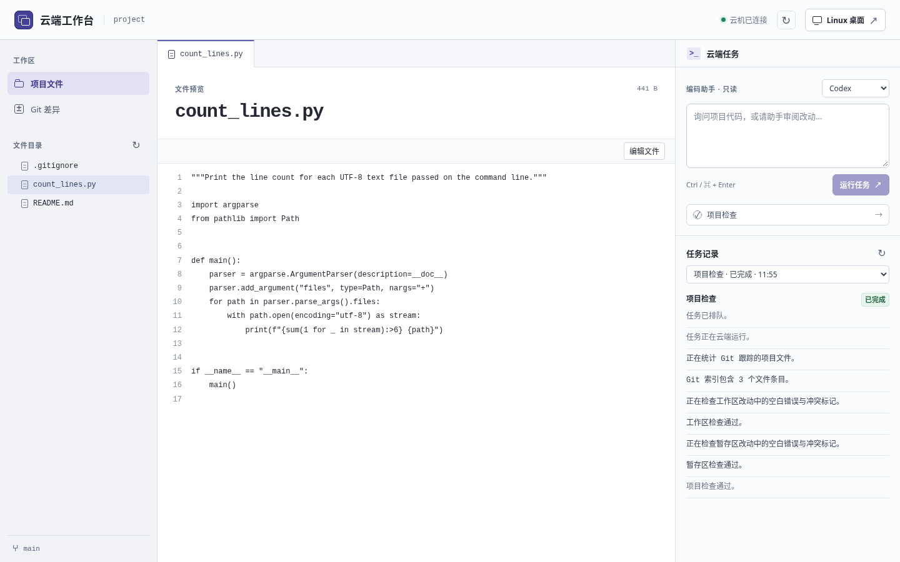

# 云端工作台

一个在本机浏览器中使用云端 Linux 项目的图形客户端。文件预览、编辑器、差异和编程助手输出由本机渲染。Linux 图形桌面可以在单独的窗口中打开，和这些工具访问同一台机器。

第一次使用可以下载已在 InstaBox 验证的 [0.1 发布包](https://github.com/yunxikj6/GUI/releases/tag/v0.1.0)。继续开发请从[项目需求](docs/requirements.md)和[开发交接](AGENTS.md)开始。



## 连接云机

在本机安装 Python 3.10 或更新版本，解压源码，在含有 `launcher.py` 的目录运行下列命令。云机需要 InstaBox 的 Linux 实例、Python 3 和 Git。图形桌面功能使用带桌面的模板。客户端运行只需 Python 标准库，桌面浏览器依赖已随包附带。

```sh
python3 launcher.py
```

Windows 可双击 `Start.cmd`，macOS 可双击 `Start.command` 或从终端运行上面的命令。输入 InstaBox 密钥时终端不会回显，已配置的 `INSTABOX_API_KEY` 也可使用。程序会打开本机浏览器。若有多台实例，用 `--machine m_…` 选择。可用 `--no-browser` 仅打印本机地址。请保持启动器运行，关闭它会断开本机连接；已接受的任务由云机持有。

首次连接会启动或恢复所选实例，并在 `/data/cloud-workspace/project` 中准备一个独立的示例 Git 项目。有现成项目可指定其在云机上的绝对路径。下面的命令读取已有目录：

```sh
python3 launcher.py --remote-project /data/workspace/my-project
```

密钥只交给本机启动器。云机工作进程、网页、交付包均不需要保留账户密钥。客户端监听 `127.0.0.1`，校验 HTTP Host 和网页 Origin。实例通信通过 InstaBox 官方 HTTPS API 完成。云机不用额外开放端口。选择项目意味着允许本机查看及编辑该目录中支持的文件。

## 首次使用

1. 在左侧打开 `README.md`，选择“编辑文件”，输入一行文字并保存。切换到“Git 差异”即可查看云端实际改动。两端同时修改同一版本时，保存会提示冲突并保留本页草稿。
2. 在“云端任务”点击“项目检查”。检查会读取真实 Git 索引，并分别检查工作区与暂存区。任务的请求 ID、状态、输出和游标保存在云机。刷新页面或重启本机启动器后可以接回记录。
3. 选择 Codex 或 Claude Code，输入希望它分析的问题。这一版支持一次性只读模型任务。模型调用使用云机中对应 CLI 的登录或 API 配置；InstaBox 密钥只负责机器访问。在云机使用自己的模型账户完成官方登录后可直接重试。
4. 点“Linux 桌面”打开 Xfce。选择接管后可以操作应用，用完可以交还控制。桌面默认使用 noVNC，连接受限时支持逐帧模式。

## 实现

| 组成 | 职责 |
| --- | --- |
| `launcher.py`、`web/` | 本机 HTTP 服务、同源校验、工作区界面、草稿及重连 |
| `instabox.py` | 选择与唤醒机器、按内容摘要部署工作进程、调用官方 API |
| `cloud/workspace.py` | 受限的文件访问、按文件版本保存、Git 差异与工作区请求 |
| `cloud/tasks.py` | 独立任务进程、SQLite 记录、请求去重、分页事件补读 |
| `desktop.py`、`desktop_assets/` | 私有桌面连接、noVNC WebSocket 代理、备用截屏和输入 |

应用工作进程按版本安装在云机的 `/data/cloud-workspace/runtime/`。任务数据库位于远端用户的 `${XDG_STATE_HOME:-~/.local/state}/cloudwork/`，按项目目录隔离。项目文件和模型登录归云机用户管理。当前图形客户端连接单台机器、一个工作目录；切换机器或项目可重启启动器。云机休眠期间任务暂停，恢复后以实际进程状态为准。

## 开发与验证

本机 Linux 开发模式使用相同文件与任务代码，需要 Git。先运行回归，再启动一个临时工作区：

```sh
python3 -m unittest discover -s tests -v
python3 launcher.py --local --project "$(mktemp -d)/project"
```

保持启动器运行，在另一个终端执行 `python3 tools/measure.py --file README.md --samples 15` 可测量当前模式的文件读取往返。浏览器自动化测试需要 Python Playwright 和 Chromium，缺少时测试标记跳过。具体环境、实测结论、限制与下一轮实验见项目文档。

- [架构调研与选型依据](docs/technology-review.md)
- [GTK 图形工具包实验](docs/toolkit-experiment.md)
- [首版实机验收和性能记录](docs/validation.md)
- [桌面查看器第三方许可](desktop_assets/NOTICE.txt)
