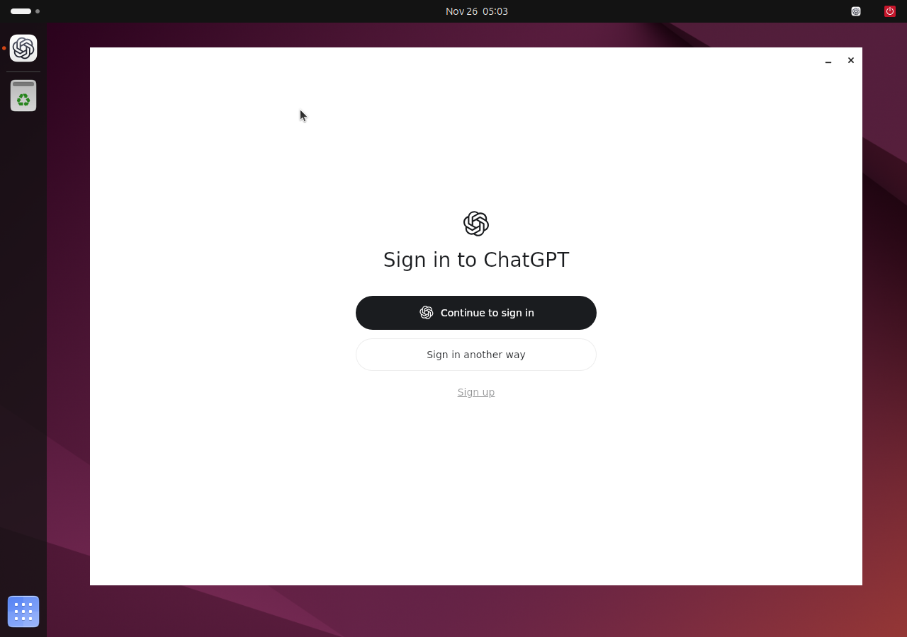
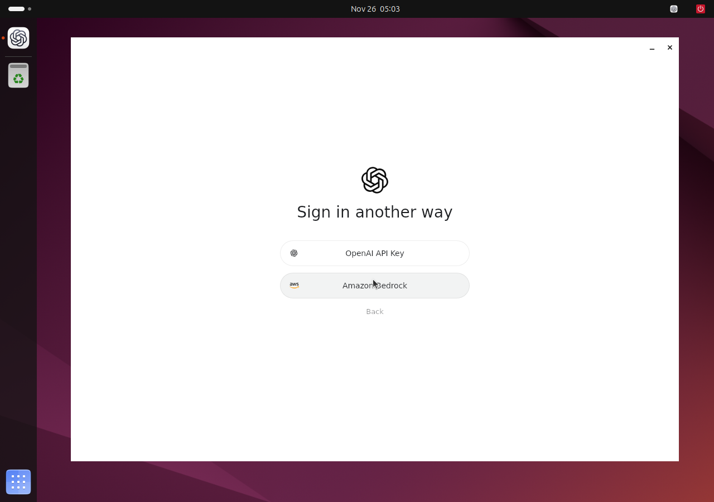

# 在本机把原厂应用绘进 GNOME 窗口

这是一组可以重复执行的登录前双状态图形实验。用户在 Ubuntu GNOME 的 Dock 点击原版 ChatGPT，进入欢迎页，再点 “Sign in another way” 打开登录方式。源端保存 GNOME 的 Mesa 绘图命令，以及同一 ChatGPT 进程在这两个状态生成的 SkPicture。独立显示端先执行 SkPicture，再把本机生成的纹理交给 VirGL，由 GNOME 的原有指令完成桌面合成。





## 来源与显示条件

源记录把独占 CDP 的官方 ELF、PID 288、进程启动时钟 6581434、设备与 inode 对到了内核识别的 Wayland 客户端。连接 1 的 surface 33 对应 xdg_toplevel 41，应用标识为 chatgpt。Mutter 的同一次访问继续关联到 Cogl 对象、GL texture 31 和 VirGL resource 213 的第一次创建。窗口提交编号来自真实的 wl_surface.commit。鼠标光标使用单独的 surface，保留其原有路径。[身份、输入摘要与测量](measurements/application-surface/capture.json)

消费端要求来源发布方已经确认资源的创建代次、应用进程实例、surface、提交编号及绘图摘要。引用命中后，才用 Skia 在本地重绘完整窗口。局部 damage 也能用相应已确认的完整提交恢复显示。遇到缺图的提交，显示端暂停呈现；检测到绑定资源仍携带云端位图或收到旧代次的引用，校验失败。非绑定的普通桌面资源照常由 GNOME 处理。[消费端与提交校验](../experiments/application_surface.py)

## 实测结果

| 状态 | 全桌面不同像素 / 1,152,000 | 全桌面 RGB 平均绝对误差 / 255 | 窗口外不同像素 / 323,600 |
| --- | ---: | ---: | ---: |
| 欢迎页 | 4,884 | 0.10480 | 0 |
| 登录方式菜单 | 4,178 | 0.09952 | 0 |

本批 61 次应用纹理更新包括 25 次整窗、36 次局部更新。源端共剔除 90,391,520 字节的应用栅格数据。显示端收到的桌面命令 gzip 为 8,502,364 字节，两份原厂绘图合计 3,815,835 字节。8 个提交有可验证的原厂绘图。79 次扫描输出中有 23 次发生在等待期间。对照回放与全部 79 张源端 GPU 扫描的哈希相同。

窗口右上角 64×36 区域来自原版 Electron 浏览器进程的三层绘图，分别绘制标题栏底色、最小化和关闭按钮。我们用原厂 Window Controls Overlay 的几何、图层名称、本次进程身份、SkPicture 摘要核对这些绘图。Windows 端实际执行原厂的裁剪、变换、填充和路径指令。两种正常状态下，这个区域各有 2,282 个像素与原生窗口完全相同，另外 22 个像素的最大通道差为 1/255。按钮悬停、按下及其他主题仍需单独采集。页面内剩余的差异集中在字体光栅化。对照图和八倍放大的 RGB 差异图可以分别核对。[欢迎页原图](measurements/application-surface/before-source.png) · [欢迎页差异](measurements/application-surface/before-difference.png) · [菜单原图](measurements/application-surface/after-source.png) · [菜单差异](measurements/application-surface/after-difference.png)

源端为隔离 Ubuntu。显示端在断网的 Wine 10 沙箱中运行官方 Windows x64 Node.js 24.22.3、CanvasKit full 0.42.0、Win64 Python 3.13.9 和原生 VirGL/WGL DLL。该沙箱只收到已剔除窗口栅格的命令与原厂绘图。Node.js 的压缩包和可执行文件各自通过官方 SHA-256 校验。Windows 11 真机仍待验证。[Node.js 官方摘要](https://nodejs.org/dist/v24.22.3/SHASUMS256.txt)上述提交来自保存的同一场次记录。持续会话配对须在 Skia 快照前后读取可靠的原生 surface 提交，发生缺失、乱序或变更时等待新的完整状态；源码为这个边界提供了独立的回归。当前默认客户端入口未启用此实验。

## 复现

从仓库根目录运行。准备阶段使用此次专用源记录目录，其中包含清单钉住的原始命令 gzip、进程与资源的独立记录，以及原厂页面、标题栏绘图和独立样式收据。生成的 prepared 目录只包含源端剔除应用像素后的桌面命令、两份绘图和本次已验证的引用表。已有 prepared 目录可直接用于第二步。

```sh
python -m experiments.replay_application_surface prepare EVIDENCE prepared
```

在 x64 Windows 的显示端安装 Node.js、Python，并准备实验使用的原生 VirGL 依赖。运行时会核对固定的上游文件摘要。输出文件 before.bgrx 和 after.bgrx 是最终本地桌面的顶行优先 BGRX。源端记录与本地渲染的对照不需要账户。

```sh
python tools/prepare_virgl_windows.py virgl-runtime
python -m experiments.replay_application_surface render prepared output --runtime-dir virgl-runtime
```

可用 Pillow 分组对比本地结果。区域的右边界和下边界为开区间。测试本身不需要 Windows GPU。

```sh
python -m experiments.application_surface_diff docs/measurements/application-surface/before-source.png output/before.bgrx --raw-size 1280 900 --region 124 67 1214 827 --difference before-difference.png
python -m experiments.application_surface_diff docs/measurements/application-surface/after-source.png output/after.bgrx --raw-size 1280 900 --region 124 67 1214 827 --difference after-difference.png
python -m unittest discover -s tests -p test_application_surface.py
```
