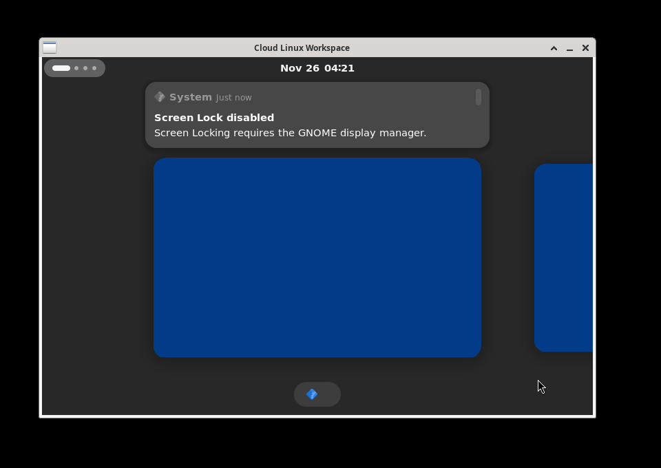
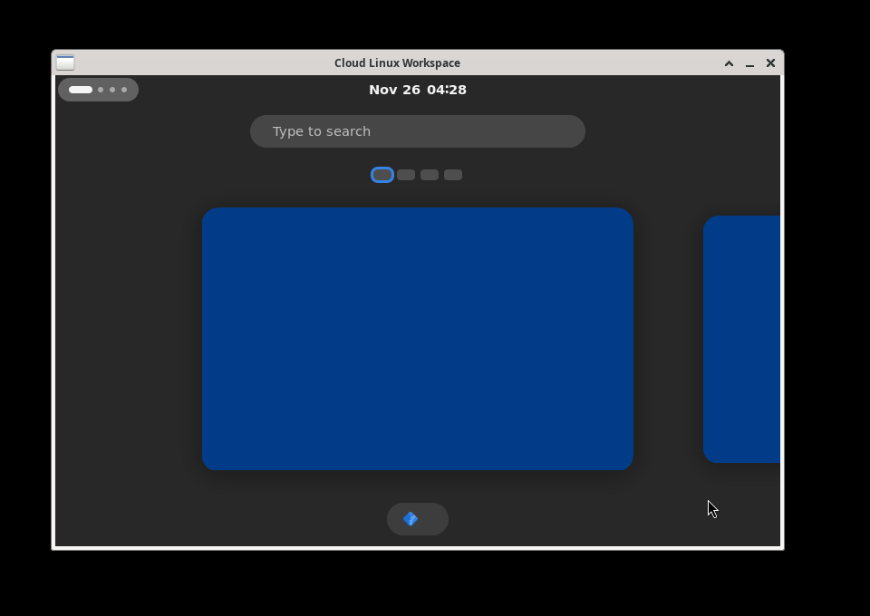

# 原版 GNOME 桌面的绘制指令

GNOME Shell 与 Mutter 在应用侧完成布局、焦点和动画。Mesa 的 virpipe 驱动发出实际绘制命令、着色器、缓冲和纹理资源。采集器通过 vtest 的内联资源模式把这些请求复制给显示端。显示端启动自己的 virgl 渲染进程。原桌面的 GPU 回读只返回给发出请求的 GNOME，采集文件仅含请求字节。[采集与回放源码](../experiments/gnome_command_stream.py)

在 Ubuntu 24.04 的嵌套 GNOME Shell 46 上打开活动概览后，录制了 400 条绘制调用和 734 次资源上传。显示端随后在另一个隔离环境中回放这 8,123,980 字节，启动时只得到命令文件与自身渲染依赖。11 次 800 × 520 的 GPU 输出逐字节匹配，其中有 9 个不同的画面。另一个 X11 客户端独立读取本机窗口，11 次窗口 RGB 均匹配相应渲染结果。[测量数据](measurements/cloud-render.json)



一次实时测试把采集侧和显示侧放在独立的 Linux 命名空间，两者通过同一物理机上的 TCP 连接传输 8,678,236 字节绘图请求。本机两次按下 Super，两个按键分别到达源端 GNOME，活动概览关闭后再次展开。源端与显示端各自运行软件 GPU。48 次输出逐字节相同，从本机实际窗口读回的 48 次像素也全部吻合。该次测试使用专用的 Super 键回传通道，完整桌面输入与真实跨网时延仍需验收。



## 在独立 Linux 显示环境复现

采集侧需要已运行的独立 X11 测试会话、GNOME Shell 46、Mesa virpipe、virgl-server 和 Python 3.10+。显示侧需要 virgl-server、支持软件 EGL 的 Mesa 及 Python。以下命令用于自己的专用图形会话。捕获内容包含窗口上呈现的文字和图形，应保存在私人目录。

先在采集侧建立一次性的私有目录并启动 GPU 和命令采集。默认的捕获上限为 512 MiB。

```sh
umask 077
capture_dir=$(mktemp -d)
virgl_test_server --no-loop-or-fork --use-egl-surfaceless --socket-path "$capture_dir/gpu" &
python3 experiments/gnome_command_stream.py record --listen "$capture_dir/shell" \
  --gpu "$capture_dir/gpu" > "$capture_dir/desktop.vtest" &
```

等两条 Unix 套接字建立后，在同一个终端启动原版 Shell。打开活动概览并退出这个专用会话，等采集器退出即可取走命令文件。

```sh
dbus-run-session -- env GALLIUM_DRIVER=virpipe VTEST_SOCKET_NAME="$capture_dir/shell" \
  MUTTER_DEBUG_DUMMY_MODE_SPECS=800x520 gnome-shell --nested --wayland --no-x11
```

在独立的 Linux 显示环境启动一个新的 GPU。套接字建立后，回放器从标准输入读取命令，在本机输出每次实际生成的 BGRX 画面。示例的 ffplay 仅负责显示本机 GPU 已生成的像素。验收时使用独立 X11 窗口回读每一帧。文件和端口传输仍须由操作者在私有环境中提供。

```sh
umask 077
display_dir=$(mktemp -d)
virgl_test_server --no-loop-or-fork --use-egl-surfaceless --socket-path "$display_dir/gpu" &
python3 experiments/gnome_command_stream.py replay --gpu "$display_dir/gpu" \
  --width 800 --height 520 < desktop.vtest | \
  ffplay -loglevel error -f rawvideo -pixel_format bgr0 -video_size 800x520 -i -
```

当前只核对了嵌套 Mutter 的单个 800 × 520 软件显示目标。Linux 实验与 Windows 包内已发布的 ChatGPT 绘图路径分别验收。完整桌面的跨主机资源传输、Windows GPU 呈现、输入回传和桌面上应用窗口的合成都仍待实测。
