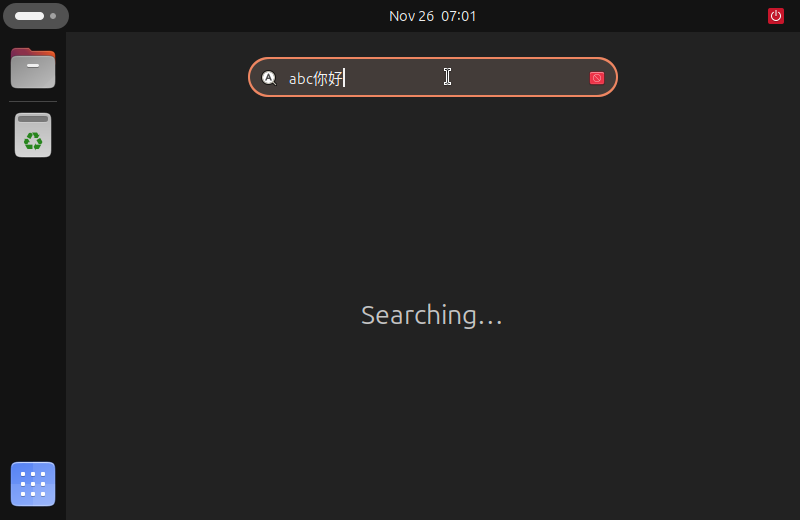

# 在原版 GNOME 搜索框中输入中文

在 Windows 客户窗口中打开 Ubuntu 活动概览，点击搜索框，输入 `abc`，再用系统拼音输入 `nihao` 并按空格选词。下面的截图取自本机可见的 Windows 客户区。原版 GNOME 搜索框显示了 `abc你好` 和插入光标。

| 实际操作 | 在窗口和原版控件中观察到的结果 |
| --- | --- |
| 输入英文 | Windows 传出三个字符。原 GNOME 搜索缓冲区的值变为 `abc`。 |
| 拼音预编辑停留两秒 | 输入法在本机维护组合串。此期间文字提交包计数和 GNOME 缓冲区变更数均为零。 |
| 按空格选定“你好” | 云端收到一次文字提交并确认修改。截图中的 416,000 个 RGB 像素全部对应同一会话的原版第 74 帧。 |
| 按 Backspace | 原搜索框的值变为 `abc你`。 |
| 按 Ctrl+A，再次用拼音提交“你好” | GNOME 在当前编辑控件内选中原文字，确认后整个缓冲区变为 `你好`。 |
| 再次开始拼音并按 Escape 取消 | 文字提交包和原缓冲区的变更计数均未增加。离开搜索框后键入的普通字符也未进入文字通道。 |

## 焦点与输入法

GNOME 源端识别本会话中的原版搜索编辑控件，并为每次获得焦点分配新的编号。Windows 在组合开始时记住该编号。原窗口用 IMM32 读取已确认的结果，输入线程携带对应的会话和焦点编号提交。源端检查当前控件，观察其原生文本缓冲区的修改后返回回执。Windows 窗口失焦时清理未完成的组合和 UTF-16 代理对。

本次系统输入法先报告组合结束，再交付结果。窗口在这两个消息之间保留原焦点编号，只接收一次结果。仅发出最终结果、没有报告组合开始的输入法无法绑定开始时的焦点，客户端会丢弃这类提交。

## 验证环境

实测使用 Wine 10 运行 Windows x64 CPython 3.13.17、Win32 HWND 和本机 WGL 绘图。系统 Fcitx 5.1.12 拼音输入法启用了 XIM 的 on-the-spot 模式。独立的 Ubuntu GNOME Shell 进程负责活动概览、搜索和中文字形。两进程通过已配对的回环会话通信。

截图测试从可见窗口读回 RGB。将相同 RGB 按原帧使用的 BGRA 顺序和全不透明 alpha 排列后，对全部字节计算的 SHA-256 与源端对应帧相同。每次测试使用固定样本文字，记录原控件是否达到预期状态及消息计数。Windows 11 实机上的微软拼音和第三方输入法仍待验收。[查看版本、操作结果和原图摘要](measurements/gnome-search-ime/receipt.json)
