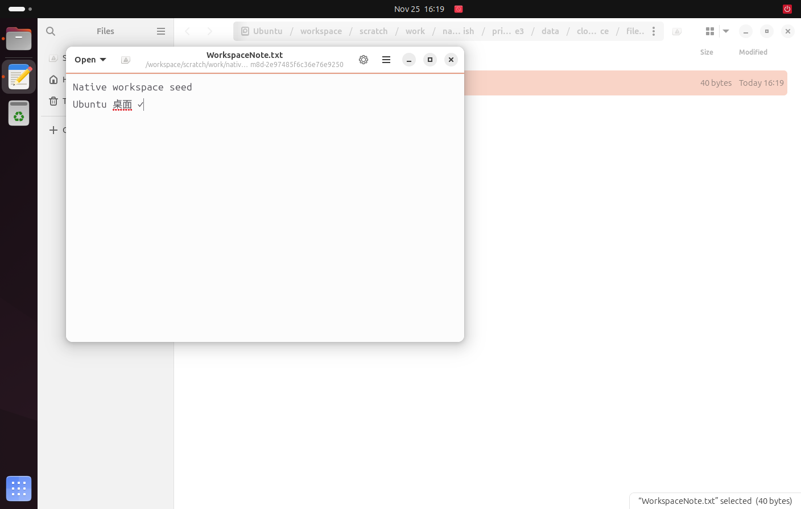

# 在 Ubuntu 文件管理器中编辑 InstaBox 项目

在 GNOME 的“活动”中搜索 **InstaBox 项目文件**（英文桌面显示 **InstaBox Project Files**）。选择一个云端文本后，系统会在 Ubuntu 文件管理器中选中本机副本。可以使用自己习惯的编辑器，也可以断开云机继续编辑已经取回的文件。

## 首次连接

在 Windows 上双击 `Setup.cmd` 安装 Ubuntu 桌面依赖，再双击 `Start.cmd`。在 Ubuntu 按 Super，搜索 **InstaBox 项目文件**。首次打开会出现系统连接对话框。

1. 选择“输入 API 密钥”，或用机器 ID 查找 Ubuntu 密钥环里的已有密钥。输入框会隐藏密钥。
2. 选择已运行的云机，输入已有项目的绝对目录，例如 `/data/my-project`。这个目录需要允许读取，云机上需要 Python 3。
3. 核对确认窗口里的机器和目录。确认后，项目会登记在本机，新输入的密钥会保存到当前 Ubuntu 用户的系统密钥环。系统可能提示创建或解锁密钥环。随后选择要打开的文件。
4. 以后要更换项目，可以在 GNOME“活动”里右键点击这个入口，选 **连接 InstaBox 项目**。

也可以在解压目录的 Ubuntu 终端设置。把下面的机器标识和绝对路径换成自己的云机和项目。

```sh
python3 workspace_mcp.py --machine m_example --project "/data/my-project" --store-key
python3 native_files.py integrate --machine m_example --project "/data/my-project"
```

第一条命令在终端隐藏输入，并将密钥保存在 Ubuntu 用户的系统密钥环。如果已为这台机器配置过工作区的 Ubuntu 密钥环，可以直接运行第二条。第二条命令登记项目，并为当前用户安装应用入口和两项 Nautilus 动作。云机的绝对项目路径可以在本机配置中查看。以后切换项目，重新运行第二条即可。

## 日常操作

1. 打开 **InstaBox 项目文件**，浏览授权项目内的目录，选择已有的 UTF-8 文本文件。单个文件上限是 128 KiB。
2. 在文件管理器中双击选中的文件。默认文本编辑器由 Ubuntu 的文件关联决定。在编辑器中按 **Ctrl+S**，修改就保存在本机。下次可以从文件管理器的“最近使用”或原目录直接打开。
3. 要发布时，在文件管理器中右键选中这一个文件，点 **脚本 → 保存到 InstaBox**。云机会核对取回时的版本，版本一致才更新。若保存时网络中断，恢复连接后可以对同一副本再次执行保存。
4. 想查看云端的新版本时，点 **脚本 → 取回 InstaBox 最新版本**。云端已有新修改时，文件管理器会打开另一份工作副本，原稿留在原处。把需要的改动合并到新副本，按 Ctrl+S，再从新副本执行“保存到 InstaBox”。

Ubuntu 24.04 上，外层会话的密钥环已经运行时，Nautilus 首次打开可能要等待桌面门户服务就绪。Linux 冷启动实测约 28 秒。

需要在另一个应用里选这份文件时，打开 Ubuntu 文件选择器的 **最近使用**。它列出刚才取回并显示的本地工作副本。若文件管理器刚打开了一份与本地草稿有分歧的云端新版本，新副本也会出现在列表里。

关闭了 GNOME 文件历史时，可以在文件管理器中单击所需文件并按 **Ctrl+C**。切到应用的“打开文件”对话框，按 **Ctrl+L**、**Ctrl+V**，再按 **Enter**。在 Ubuntu 的 GTK 3 和 GTK 4 选择器中都可以这样选中文件名含中文、空格或百分号的工作副本。

工作副本默认在 `~/.local/share/cloudworkspace/file-copies/projects/` 下，保留项目内相对目录。发生分歧时取回的副本在相邻的 `revisions/` 目录中。如果设置过 `XDG_DATA_HOME`，两个目录位于该位置的 `cloudworkspace/file-copies/` 内。文件管理器的云端动作根据选中的已登记路径确定机器和项目。

这套操作使用 InstaBox 官方 HTTPS 接口。Claude 和 ChatGPT 各自管理登录、对话与授权。想在厂商客户端对话中读取同一云项目，可以单独配置工作区工具。[官方客户端连接](official-client-workspace.md)

## 实测

在 Ubuntu 的项目文件入口逐级选择一份真实 InstaBox 文件后，Nautilus 显示了本机副本。重新启动独立的 GTK 4 文件选择器，在“最近使用”单击文件并点“打开”，返回的路径与 Nautilus 中的是同一份。读出的 16,242 字节与云端 Git 版本逐字节一致。厂商账户中的附件上传仍待登录验收。[Ubuntu 系统选择器实拍](native-insta-file-selection.png) · [文件来源与校验记录](measurements/native-attachment-selection.json)

首次连接时，用 Ubuntu 原版 Zenity 从密钥环复用测试所用云机的凭据，选中真实机器、输入临时项目目录并确认。从 GNOME 活动搜索并打开项目入口，在系统选择器点选云机上的文件。这一步首次建立本机副本，随后 Nautilus 46.4 自动选中该文件。双击用 GNOME Text Editor 46.3 保存中文后，回到原来那个 Nautilus 窗口点击“脚本 → 保存到 InstaBox”。桌面收到保存通知，随后独立从云机磁盘读回 40 字节，与本机逐字节一致。让云机先修改文件后再发布，旧稿收到冲突，取回新副本、合并后发布成功。[保存菜单原图](native-cloud-file-menu.png) · [往返测量](measurements/native-project-files.json)

另一次验收中，GNOME、Nautilus 和文本编辑器只能使用回环接口，没有对外 IP 路由。双击、输入 `Ubuntu 桌面 ✓`、按 Ctrl+S 均可操作。本机文件从 22 字节变为 40 字节，此时独立读取云机磁盘仍为 22 字节。两次实测都使用 Linux 图形环境。[Windows 验收范围](native-windows.md)


