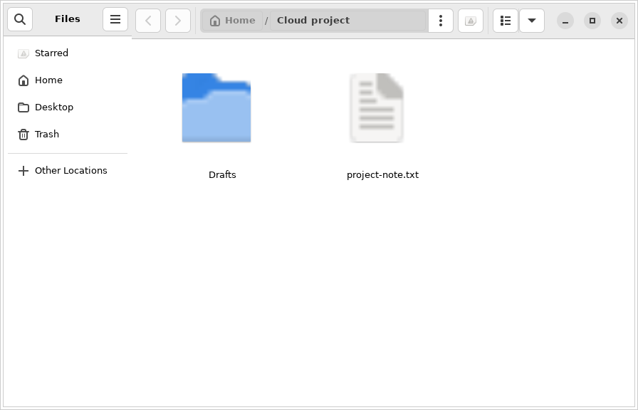
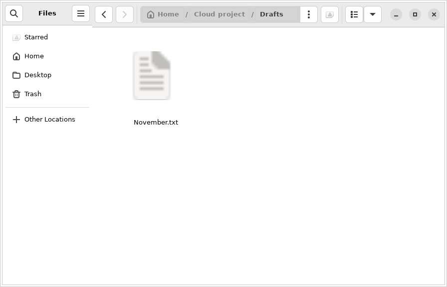

# 用 Windows 绘制 Ubuntu 原版文件管理器

Ubuntu 24.04 的 Nautilus 从源端文件系统读取项目目录。它的 GTK 4 GL 渲染器生成了 3,760 次实际绘制调用。独立的 Win64 进程接收这些指令、着色器、字形和图标资源，用本机的 VirGL 和 OpenGL 绘制窗口。原进程收到的 GET 回读仅在源端返回，本次流中对显示目标的图像上传次数为零。



源端进入 Drafts 后，Windows 的同一图形进程绘出了子目录。两次分别读取源端的 X11 窗口和 Windows 窗口，每次 896×576 的 516,096 个 RGB 像素都相同。67 个本地 GPU 回读摘要也逐个匹配。该验证在隔离的 Ubuntu 源环境及 Wine 10 下运行的 Win64 CPython 3.13.17 中完成。本次目录操作在源端执行，Windows 使用保存的指令验证本地重绘。默认云桌面的文件夹入口接入与真实 Windows 11 分别验收。[精确测量](measurements/original-gtk-files.json)



## 在专用 Ubuntu 源会话采集

在已经运行 X11 与 D-Bus 的专用 Ubuntu 会话中，用单独的 HOME 和会话总线启动 Nautilus。私有套接字检查对端 UID 以及运行中的 `/usr/bin/nautilus` 可执行文件。`GSK_DEBUG=full-redraw` 使 GTK 每次更新都发布完整的绘制操作。本机仍执行原应用的绘图。

```sh
umask 077
run_dir=$(mktemp -d)
GALLIUM_DRIVER=llvmpipe LIBGL_ALWAYS_SOFTWARE=1 virgl_test_server --no-loop-or-fork --use-egl-surfaceless --socket-path "$run_dir/gpu" &
python -m experiments.gnome_command_stream record --application nautilus --listen "$run_dir/files" --gpu "$run_dir/gpu" > "$run_dir/files.vtest" &
```

等两个套接字建立后，在同一云端图形会话的 shell 中运行以下命令。将最后一个参数替换为要浏览的源端目录。退出这个专用 Nautilus 会话后，采集器结束。

```sh
GDK_BACKEND=x11 GSK_RENDERER=gl GSK_DEBUG=full-redraw GALLIUM_DRIVER=virpipe LIBGL_ALWAYS_SOFTWARE=1 VTEST_SOCKET_NAME="$run_dir/files" nautilus --new-window "$HOME"
```

## 在 Windows 绘制

使用本次实验的源码、Windows x64 Python 以及项目固定的 VirGL DLL。调用 `thin_client.virgl_windows.replay(commands, present, renderer=b'nautilus', runtime_dir=runtime)`，其中 `commands` 是二进制命令流，`runtime` 是已校验的 Windows DLL 目录，`present` 在本机收到实际绘出的宽、高和顶行优先的 BGRX 数据。`thin_client.gnome_window.NativeWindow.present` 可显示这块数据，窗口所有者线程应持续处理 Win32 消息。

Nautilus 的 Mesa vtest 0 驱动在读取显示缓冲前先等待同一资源的 GPU 同步回执。源侧保持原始请求顺序，把该同步回执先返回给应用，再返回保留在云端的本次回读。发生资源错配、缺少回执、上传整幅显示目标或本机收到错误渲染上下文时，本次采集或显示终止。
