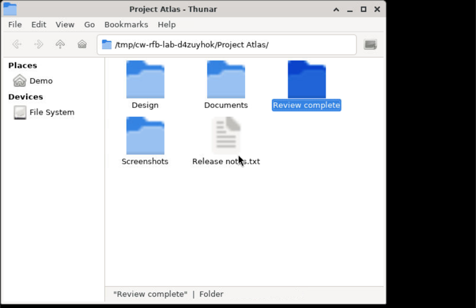

# 直接进入云机上的原桌面

运行 `python3 launcher.py` 后，远端模式打印并打开 `/desktop/`。在地址栏输入启动器的根地址也会转到此处。若桌面已在运行，查看器读取状态后连接同一会话。等待看到画面后，点击“接管输入”即可使用 Xfce 应用程序菜单。需要文件、Git 或助手工具时，点桌面顶栏的“工作台”，也可直接启动 `python3 launcher.py --workbench`。[使用说明](../README.md)

查看桌面无需安装项目工作进程，也无需先创建示例仓库。首次使用工作台的项目接口时才准备相应版本的进程。多个同时发起的请求共用首次安装的结果。本机开发模式 `--local --project` 的默认入口仍是本地工作台。[入口回归](../tests/test_desktop_entry.py) · [工作进程初始化回归](../tests/test_lazy_workspace.py)

## 从默认入口观看原有云桌面

正常启动器连接现有 InstaBox 后打印 `/desktop/`。Chromium 从裸根地址收到 302，并在桌面页通过正式 `/desktop/vnc` 连接当前会话。客户端收到 34,499 字节，解码了 28 个像素矩形，前台画布完成 2 次绘制，状态为“正在观看”。连接前后由同一控制方持有输入，观察期间接管请求、键鼠输入和剪贴板访问均为 0。另开 `/workbench/` 后才第一次读取该项目，能看到真实分支和文件树。本次只记传输与绘制计数，原登录桌面的画面没有保存。[正式云桌面回执](measurements/desktop-entry.json)

## 在云机原版文件管理器中新建目录

在实际 InstaBox 上运行 Debian 软件包 `thunar 4.20.2-1+deb13u1`。本次操作使用独立 X11 显示、临时主目录和测试文件。Chromium 加载项目随包的 noVNC 查看器，在画布中按 Ctrl+Shift+N。X11 报告属于 Thunar 进程的两个窗口，主窗口为“Project Atlas - Thunar”，对话框为“Create New Folder”。在对话框输入 `Review complete` 并按 Enter 后，通过云机文件系统独立确认了同名目录。[窗口和文件系统记录](measurements/thunar-desktop.json)



截图取自实际接收的 RFB 画布。实验使用控制状态夹具以及官方 HTTPS exec 到私有 TigerVNC Unix 套接字的中继，测试结束后关闭独立显示。正式桌面的入口检查与这次应用操作分别进行。此处验证的是原应用在完整云桌面中的操作。窗口管理器仍在云机上，公网延迟、中文输入法和跨平台快捷键需要各自实测。

## 回归

本机从独立源码快照运行 167 项回归，全部通过，零跳过。其中 67 项使用 Chromium，9 项使用原生模型 CLI。耗时 220.719 秒。[测试清单](measurements/regression-desktop-entry.txt)

```sh
python3 -m unittest discover -s tests -p 'test_desktop*.py' -v
python3 -m unittest discover -s tests -v
```
