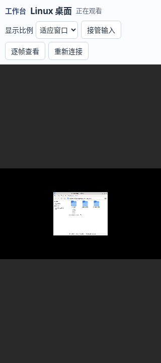
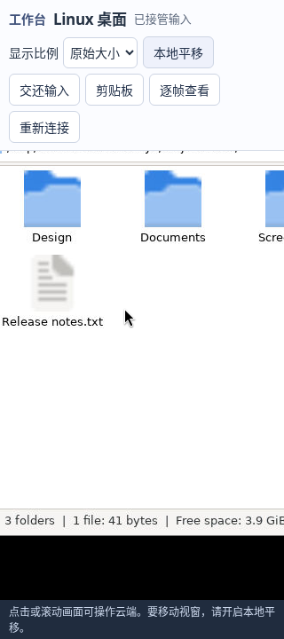

# 在完整云桌面按原始大小阅读

工具栏“桌面显示比例”默认选择“适应窗口”，整块云桌面都在视野内。需要看清小字时选“原始大小”，每个云桌面像素占一个浏览器 CSS 像素。浏览器和操作系统的缩放仍会影响最终显示尺寸。这个选择只作用于当前查看器；云机分辨率和应用窗口布局由云机继续管理。[使用说明](../README.md)

## 旧版为什么难以阅读

在独立 Linux 测试桌面上，用原版 Thunar 4.20.2 打开测试目录。测试桌面的分辨率为 1920 × 1080，File 菜单的字形在原图中高 11 像素。下表按实际画布与源画面的比例计算该字形在浏览器中占多少 CSS 像素。每个条件都通过菜单和双击测试文件夹核对了鼠标落点。旧版提交为 `ac31f92`。[测试窗口、画布尺寸和菜单记录](measurements/desktop-scale.json)

| 旧版的显示条件 | 字形在浏览器中的高度 |
| --- | ---: |
| 1272 × 709 的笔记本视口 | 6.63 CSS 像素 |
| 同一显示器，Chromium 页面缩放到 125% | 5.19 CSS 像素，约合显示器上的 6.49 像素 |
| 桌面浏览器全屏，1360 × 768 | 7.23 CSS 像素 |
| 360 × 720 的窄屏视口 | 2.06 CSS 像素 |
| 320 × 640 的窄屏视口 | 1.83 CSS 像素 |

整桌面自动适应时，浏览器放大也会缩小可供画布利用的视口。单纯切到浏览器全屏可以利用更多空间，但在这一组条件下依然小于原来的字形。

## 在 InstaBox 看同一扇窗口

两张截图来自同一台 InstaBox 的隔离测试桌面。云端 `/usr/bin/thunar` 打开了有三个文件夹和一个文本文件的测试目录。浏览器视口宽 320、高 720 CSS 像素。左图中整块 1920 × 1080 桌面缩为 320 × 180，右图在原始大小下平移到文件列表，可以读到 `Design`、`Documents` 和 `Release notes.txt`。测试前后云机均保持 1920 × 1080。[尺寸、指针与窗口记录](measurements/desktop-scale.json)

| 适应窗口 | 原始大小，平移至文件列表 |
| --- | --- |
|  |  |

接管测试桌面后，在浏览器坐标 (100, 270) 单击 File，云机指针落在预期的 (658, 326)，X11 出现了原生弹出菜单。再平移到文件列表，在浏览器坐标 (195, 228) 点选 Documents，云机指针落在 (1015, 421)。等选中状态显示出来后按 Enter，云端窗口标题变为 `Documents - Thunar`。这次测试使用私有 Unix 套接字，结束时已关闭独立桌面。

已有的 InstaBox 用户桌面另外通过正常启动器核对。根地址跳转到 `/desktop/`，进入时显示“正在观看”。在 390 像素宽的视口中，同一条实时连接先显示 390 × 242.61 的全貌，再显示 823 × 512 的原始画面，最后恢复为初始尺寸。云机分辨率和输入控制归属保持原值，全程没有远端键鼠、剪贴板或调整分辨率请求。这个检查只记录了数值，以上两张截图均来自隔离测试目录。

## 自行复核

1. 运行 `python3 launcher.py`，连接已有的 InstaBox 桌面，把浏览器窗口缩窄。在“显示比例”选择“原始大小”，拖动画面找到一个已打开的应用。
2. 点击“接管输入”，打开“本地平移”，将需要操作的菜单或文件图标移入视野。关闭“本地平移”后点击目标，查看原应用的菜单或窗口标题。
3. 选回“适应窗口”，确认能看到整个桌面。也可以在同一页切换“逐帧查看”和“切回实时”，核对仍采用所选比例。

## 回归

Chromium 通过触屏模拟滑到画面的四个角，检查浏览器实际绘制的像素、边缘横滑后的 URL 及 RFB 上的键鼠消息。接管后还检查了移动视野后的点击与滚轮坐标，以及逐帧换图期间的输入。触屏测试运行在 Linux Chromium 上，尚待物理手机复验。[桌面显示回归测试](../tests/test_desktop_scale_ui.py)

本机从独立源码快照运行 169 项回归，全部通过，零跳过。其中 69 项使用 Chromium，9 项使用原生模型 CLI。耗时 254.383 秒。[测试清单](measurements/regression-desktop-scale.txt)

```sh
python3 -m unittest discover -s tests -p 'test_desktop*.py' -v
python3 -m unittest discover -s tests -v
```
