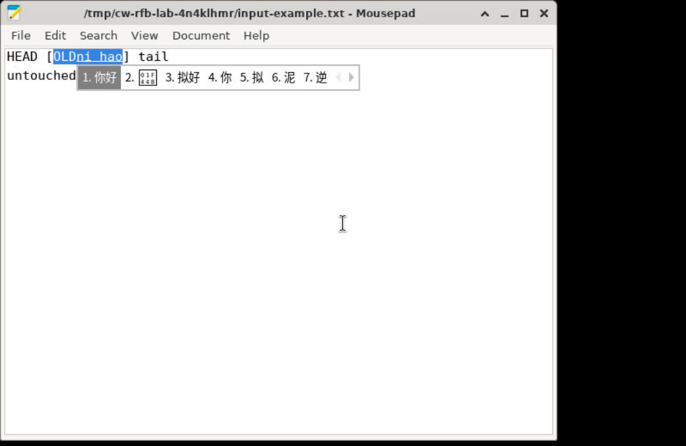

# 桌面输入与原程序保存的文字

接管实时桌面后，可以向云端剪贴板发送中文、emoji 和多行正文。打开顶栏“剪贴板”，粘贴到“发送到云端的文本”并点击“发送到云端”，然后在原应用中使用它的“粘贴”命令。已经配置云端输入法的桌面也可以在原应用内选字。此次核对的实例装有中文字体，系统包清单中没有 IBus 或 Fcitx。[实时剪贴板验收](validation-desktop-clipboard.md) · [系统包和输入实测](measurements/desktop-frame-text.json)

## 原版软件里的拼音候选窗

在实际 InstaBox 的独立测试桌面中运行 Debian 原版 Mousepad 0.6.3 和 Fcitx5 拼音。浏览器只转发正常按键。在 Mousepad 里选中 `OLD` 后，按测试桌面已配置的 Ctrl+Space 切换到拼音，再输入 `nihao`。X11 记录到由云端输入法绘制的 `Fcitx5 Input Window`（331 × 31 像素）。下图是当时查看器收到的桌面画面。[云端候选窗与保存记录](measurements/desktop-native-pinyin.json)



按空格选“你好”，随后在原应用按 Ctrl+S。云机磁盘上的第一行从 `HEAD [OLD] tail` 变成 `HEAD [你好] tail`，第二行 `untouched: 月光` 及末尾换行完整保留。云端剪贴板也保留了原文。[保存后的原软件窗口](desktop-native-pinyin-saved.png)

已有 Fcitx5 拼音的桌面可在实时画布中用自己的输入法切换键复核这组动作。本次实验在独立目录内临时解包并校验 Debian 软件和词库，退出后确认目录已清理。当前已有桌面的系统包清单里没有 Fcitx5，日常使用这台实例时可走上面的实时剪贴板路径。

## 逐帧模式

在连接受限而切到逐帧查看后，“发送文字”模拟键盘输入，支持 1 至 2048 个可打印 ASCII 字符（空格至 `~`）。输入中文、emoji、控制字符、多行文字或超长文本时，查看器在发送前保留整段原文，并说明下一步操作。可以先复制输入框中的文字，再切回实时桌面。交还控制或重新连接会清空这个输入框。

输入法还在选字时点击“发送文字”，拼音草稿会留在本机。成功收到执行回执后，查看器清除已发的那份草稿。等待期间修改过的文字仍会保留。连接中断、未收到有效回执时，页面保留草稿和状态提示。此时可以先看云端应用中已有的正文，再决定要补输哪些文字。

## 从 HTTP 回执核对到磁盘

在 InstaBox 的临时 X11 显示中运行 Debian 原版 Mousepad 0.6.3。测试将正式 `/desktop/input` 处理器的 X11 输入定向至该显示，通过原软件的 Ctrl+S 保存，再从云机读取同一文件的 UTF-8 字节。Mousepad 与依赖解包在临时目录，测试结束后回收该目录。现有用户桌面和文件均未用于这些输入测试。[测试结果](measurements/desktop-frame-text.json)

| 在编辑器中输入 | 原版本 `c984507` | 修复后 |
| --- | --- | --- |
| `FrameOK-42:[] !` | 返回 200，标记与原文完整保存 | 返回 200，标记与原文完整保存 |
| 含中文、emoji 和重音字母的单行文字 | 返回 200，文件中缺少 🙂 | 返回 422，派发零次，原文件完整 |
| 两行 ASCII | 返回 200，换行消失 | 返回 422，派发零次，原文件完整 |
| 含中文、emoji 和换行的整段文字 | 返回 200，保存的字节与请求不同 | 返回 422，派发零次，原文件完整 |

直接调用接口的客户端也会收到以上 422。需要发送单个 Tab 或 Return 按键时，可继续使用 `key: "press"`。HTTP 执行成功表示按键已经发出，具体操作效果由当时获得焦点的原程序决定。

## 回归

本机从独立源码快照运行 171 项回归，全部通过，零跳过。其中 70 项使用 Chromium，9 项使用原生模型 CLI。耗时 400.598 秒。[测试清单](measurements/regression-desktop-frame-text.txt)

320 像素宽的真实 Chromium 从系统剪贴板粘贴整段测试文字，验证草稿保留、选字时误点、快速双击、断线和迟到回执。接口测试另外检查了可打印字符范围、长度边界和整段拒绝。[浏览器测试](../tests/test_desktop_frame_text_ui.py) · [接口测试](../tests/test_desktop.py)

```sh
python3 -m unittest discover -s tests -p 'test_desktop*.py' -v
```
